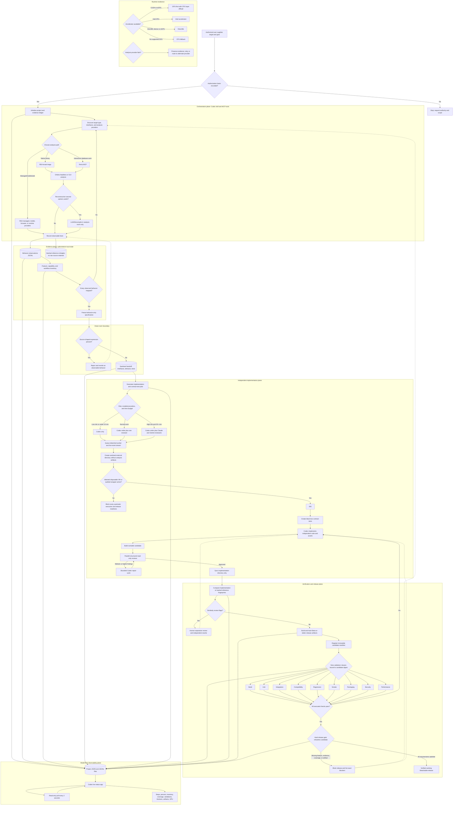
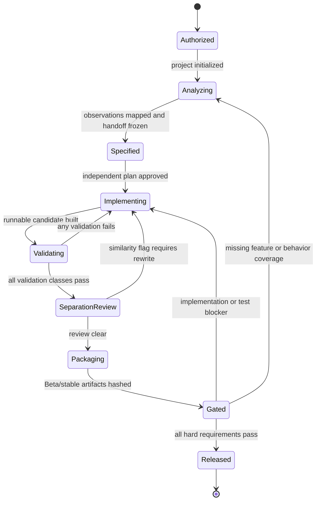

# End-to-end process and control chart

This chart distinguishes the orchestration plane, evidence plane, clean-room boundary, implementation plane, verification plane, and model-free observability plane. Solid arrows are the normal automatic path. Dashed arrows are recovery or review loops.

## State machine

## Automation invariants

1. Decompiler or reconstructed source never crosses into the implementation handoff.
2. The dashboard is read-only and does not call a language model.
3. A failed or absent check is never treated as passing.
4. Every non-uncertainty observation must map to inventory and compatibility evidence.
5. Release artifacts are hashed and must be at least Beta maturity.
6. Similarity results are review signals, never legal clearance.
